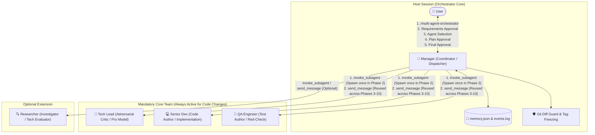
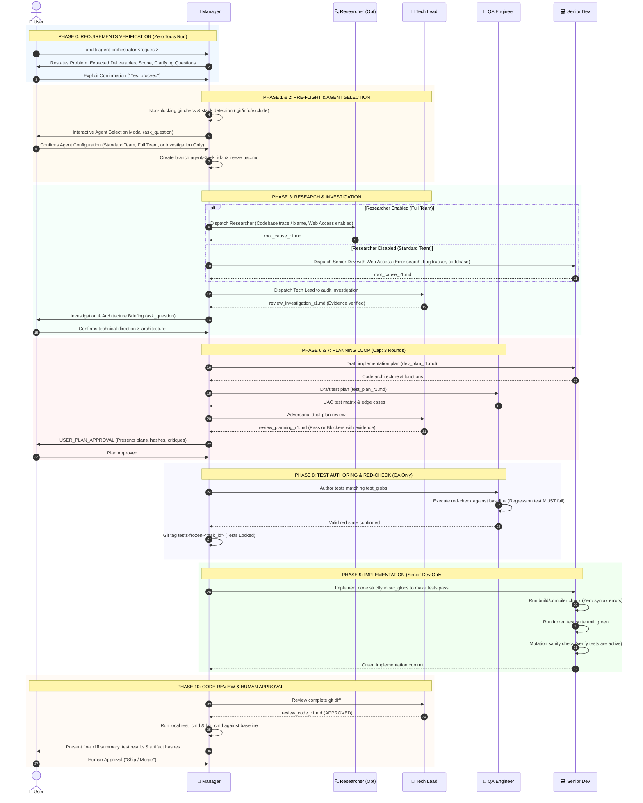
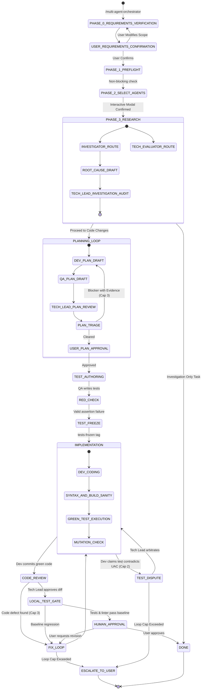

# Multi-Agent Software Engineering Orchestrator (v6.2)
## Complete Architecture & Operational Workflow

---

## 1. High-Level System Architecture

The orchestrator operates as a **Host-Native Antigravity Plugin** using git-branch isolation, mechanical boundary guards, and strict separation of concerns across specialized subagents.

---

## 2. Strict Role Boundary Matrix

| Role | Classification | Core Responsibility | Permitted File Boundary | Forbidden Actions |
| :--- | :--- | :--- | :--- | :--- |
| **`Manager`** | Host Session | Pipeline coordination, state tracking, git guards, baseline test runner. | Manifests in `DEP_SETUP` only; `.agent/tasks/**`. | **STRICTLY FORBIDDEN** from viewing application source code directly, debugging, or writing code. |
| **`Senior Dev`** | **Mandatory** | Implementation planning (`dev_plan_r<N>.md`), interface contracts, production code. Assumes codebase investigation (with Web Search access) if Researcher is absent. | `paths.src_globs`, interface stubs. | **STRICTLY FORBIDDEN from writing tests or test plans.** Senior Dev is NOT a tester. |
| **`QA Engineer`** | **Mandatory** | Test planning (`test_plan_r<N>.md`), test fixtures, regression tests, red-check execution. | `paths.test_globs`, test harnesses, `paths.fixtures_globs`. | **STRICTLY FORBIDDEN from writing or modifying production code** in `paths.src_globs`. |
| **`Tech Lead`** | **Mandatory** | Adversarial critic, dual-plan audit, investigation audit, dispute arbitrator. | `.agent/tasks/**` (Review artifacts only). | **STRICTLY FORBIDDEN** from modifying repository code files. All blockers require file:line evidence. |
| **`Researcher`** | **Optional** | Internal codebase root-cause analysis (Investigator) or external package survey (Evaluator). | `.agent/tasks/**` (Research artifacts only). | Web access enabled for error signatures/docs/packages (treated as untrusted data). Never modifies code or writes tests. |

---

## 3. End-to-End Execution Sequence Flow

---

## 4. State Machine & Exception Loops

---

## 5. Mechanical Safety Guarantees

1. **Zero Premature Action Gate (Phase 0):** Zero tools, zero git operations, and zero subagents are invoked before the user explicitly reviews and confirms the restated requirements.
2. **Attribution & Rollback (Git Guard):** Every turn produces a discrete commit (`git commit -m "<role>:<state>:r<round>"`). Diff boundaries are checked against globs; any boundary violation triggers an immediate `git reset --hard HEAD~1` rollback.
3. **No Code / Test Overlap:** Senior Dev cannot modify test globs; QA cannot modify src globs.
4. **Evidence-Backed Criticism:** The Tech Lead cannot block a plan or diff on speculation; every `BLOCKER` must cite concrete `file:line`, CVE IDs, or reproduction commands.
5. **Two-Stage Investigation:** Every root-cause report drafted by the Researcher (or Senior Dev with Web Access when Researcher is OFF) must be independently verified and audited by the Tech Lead before being accepted.
6. **Single Spawn & Cognitive Continuity:** Subagents are spawned once in Phase 2; all subsequent phases, reviews, and test runs reuse the existing subagent conversations via `send_message` to eliminate context amnesia and excessive token consumption.
7. **Pre-Modal Briefing Invariant:** The Manager is strictly forbidden from triggering `ask_question` with empty or incomplete content; full markdown explanations and comparison tables must always accompany approval dialogs.
8. **CLI State Automation:** All state machine transitions, SHA1 artifact hashing, and event logs are performed atomically via `transition_state.ps1`, eliminating manual LLM JSON editing turns.
9. **Model Tiering Architecture:** Tech Lead operates on `Model: 'pro'` for adversarial criticism, while QA and Senior Dev run on `Model: 'flash'` to maximize speed and cost efficiency.
10. **Direct Profile Injection (Zero Discovery Bloat):** Subagent roles are injected directly during Phase 2 spawn with an explicit anti-discovery constraint, preventing subagents from wasting turns searching files for profiles.
11. **Single Chained Guard Per Turn (Zero Noise):** Executes commit, diff, and boundary checks in one single chained command per turn, returning ONLY `OK` or `VIOLATION` to eliminate 5–8 turns and avoid terminal bloat.
12. **Header-Only Artifact Inspection & 10-Line Output Cap:** Manager reads only frontmatter headers (`verdict`, `blocker_ids`, `hash`), while subagents return 10 lines or fewer via `send_message`, preventing context compounding.
13. **Narrowed Interface Change & Lite Path:** Adding internal/private functions is strictly `interface_change = false`, completely skipping `CONTRACT_PHASE`. Scoped tasks use compact dual plans.

