# Project Function Diagram

This diagram represents the functional structure of the project, including function definitions, parameters, and dependency relationships.

## Project Environment
- **Primary Language**: Node.js (JavaScript ESM) / WebGL (Three.js)
- **Execution Environment**: Docker container `tiktok-live-bar`
- **Additional Info**: High-performance real-time 3D interactive TikTok LIVE nightclub bar web application with procedural 3D slimes, Web Audio beat detection, and WebSocket event ingestion.

```mermaid
classDiagram
    class server_avatar_proxy_js {
        +extractInitials(name)
        +generateSvgAvatar(username, userId)
        +fetchAvatarWithCache(targetUrl, username, userId)
        +avatarProxyRouter(req, res, next)
    }

    class server_event_normalizer_js {
        +parseColorCommand(comment)
        +sanitizeComment(text)
        +extractUser(raw)
        +normalizeChat(raw)
        +normalizeGift(raw)
        +normalizeLike(raw)
        +normalizeSocial(type, raw)
        +normalizeTikTokEvent(type, raw)
    }

    class server_mock_simulator_js {
        +getRandomViewer()
        +simulateLikes(count, user)
        +simulateChat(customText, user)
        +simulateGift(tier, customGiftName, customCoins, user)
        +startAutoSimulation(intervalMs)
        +stopAutoSimulation()
    }

    class server_rate_limiter_js {
        +enqueue(event)
        +flushCombo()
        +drainQueue()
        +getQueueSize()
        +reset()
    }

    class server_server_js {
        +broadcast(payload)
    }

    class server_tiktok_service_js {
        +connect(username)
        +_bindEvents()
        +_scheduleReconnect()
        +disconnect()
        +getStatus()
    }

    class src_audio_system_js {
        +split3BandFrequency(spectrum, sampleRate, fftSize)
        +calculateAudioFlux(current, avg, smoothing)
        +synthesizeSfxParams(name)
        +getBeatStepEvents(step)
        +start(audioCtx, destinationNode)
        +_playStep(step)
        +stop()
        +setVolume(v)
        +unlockAudio()
        +getBands()
        +playSfx(name)
        +toggleMute()
    }

    class src_avatar_manager_js {
        +parseColorCommand(comment)
        +getSlimeKinematics(bpmPhase, isBouncing)
        +getDanceKinematics(style, phase)
        +touch(userId, username, coins)
        +disposeAvatar(avatar)
        +createSlimeGeometry()
        +createSlimeFaceTexture(isSmiling)
        +createAvatarMesh(userData)
        +setSlimeColor(slimeGroup, colorKey)
        +createBillboardSprite(userData)
    }

    class src_club_environment_js {
        +init()
        +createAccentLights()
        +createLedFloor()
        +createVipPodium()
        +createDjBooth()
        +createWallsAndNeon()
        +createMovingHeads()
        +createLaserBeams()
        +createFireworksSystem()
        +createFlyingHeartsSystem()
        +emitFlyingHearts(count)
        +update(delta, bands)
    }

    class src_main_js {
        +handleLiveEvent(evt)
        +getOrCreateAvatarMesh(userData, coins)
        +animate()
    }

    class src_scene_manager_js {
        +getOrbitCameraPosition(theta, phi, radius)
        +init()
        +setCameraPreset(key)
        +toggleChromaKey()
        +toggleAlpha()
        +onResize()
        +update(deltaTime, bassPunch)
    }

    class src_ui_overlay_js {
        +initElements()
        +bindEvents()
        +unlockAudioHandler()
        +bindMockButton(id, fn)
        +toggleAdminDrawer()
        +updateTikTokStatus(status)
        +addHype(points)
        +triggerFrenzyMode()
        +showGiftAlert(giftEvent)
        +updateLeaderboard(donors)
    }

    server_mock_simulator_js --> server_event_normalizer_js : imports
    server_server_js --> server_event_normalizer_js : imports
    server_server_js --> server_rate_limiter_js : imports
    server_server_js --> server_avatar_proxy_js : imports
    server_server_js --> server_tiktok_service_js : imports
    server_server_js --> server_mock_simulator_js : imports
    src_main_js --> src_scene_manager_js : imports
    src_main_js --> src_club_environment_js : imports
    src_main_js --> src_avatar_manager_js : imports
    src_main_js --> src_audio_system_js : imports
    src_main_js --> src_ui_overlay_js : imports
```

## Function Details

### server/avatar-proxy.js
- [extractInitials(name = '')](file:///e:/game/bar_room/server/avatar-proxy.js#L24-L34): Extracts a 1-to-2 uppercase character monogram from a user name, returning '?' for empty or non-string inputs.
- [generateSvgAvatar(username = 'User', userId = '0')](file:///e:/game/bar_room/server/avatar-proxy.js#L39-L61): Generates a deterministic, gradient-filled circular SVG avatar containing the user's initials when their TikTok profile photo is missing or blocked.
- [fetchAvatarWithCache(targetUrl, username = 'Viewer', userId = '0')](file:///e:/game/bar_room/server/avatar-proxy.js#L66-L116): Fetches an avatar from TikTok CDN with a 5-second abort timeout and LRU caching, falling back to a generated SVG avatar on HTTP errors or network timeouts.
- [avatarProxyRouter(req, res, next)](file:///e:/game/bar_room/server/avatar-proxy.js#L121-L148): Express route handler serving avatar images with permissive CORS headers and a 24-hour cache-control header for browser WebGL textures.

### server/event-normalizer.js
- [parseColorCommand(comment)](file:///e:/game/bar_room/server/event-normalizer.js#L38-L55): Parses !color chat commands, strictly resolving to one of 4 canonical Slime colors (green, red, blue, yellow) or Vietnamese aliases, and explicitly rejecting hex codes.
- [sanitizeComment(text)](file:///e:/game/bar_room/server/event-normalizer.js#L81-L84): Masks profane or sensitive words in chat messages by replacing matched characters with asterisks.
- [extractUser(raw)](file:///e:/game/bar_room/server/event-normalizer.js#L89-L97): Standardizes raw TikTok user attributes into a normalized identity object containing user ID, username, nickname, and avatar URL.
- [normalizeChat(raw)](file:///e:/game/bar_room/server/event-normalizer.js#L102-L113): Transforms raw chat payloads into normalized comment events, automatically extracting and attaching valid !color commands.
- [normalizeGift(raw)](file:///e:/game/bar_room/server/event-normalizer.js#L122-L148): Normalizes incoming gift payloads by calculating total coin value and categorizing gifts into one of 4 hierarchical tiers.
- [normalizeLike(raw)](file:///e:/game/bar_room/server/event-normalizer.js#L153-L160): Sanitizes like event counts and preserves cumulative total likes across the live session.
- [normalizeSocial(type, raw)](file:///e:/game/bar_room/server/event-normalizer.js#L165-L170): Normalizes social stream interactions such as follows, shares, and member joins.
- [normalizeTikTokEvent(type, raw = {})](file:///e:/game/bar_room/server/event-normalizer.js#L178-L205): Central dispatcher that converts any incoming raw TikTok event into a unified, timestamped event schema.

### server/mock-simulator.js
- [getRandomViewer()](file:///e:/game/bar_room/server/mock-simulator.js#L52-L54): Selects and returns a randomized mock viewer profile from the default mock viewer pool.
- [simulateLikes(count = 10, user = null)](file:///e:/game/bar_room/server/mock-simulator.js#L56-L65): Generates and emits a synthetic like event for testing without an active stream.
- [simulateChat(customText = null, user = null)](file:///e:/game/bar_room/server/mock-simulator.js#L67-L76): Generates and emits a synthetic chat event with predefined or custom text.
- [simulateGift(tier = 1, customGiftName = null, customCoins = null, user = null)](file:///e:/game/bar_room/server/mock-simulator.js#L78-L95): Generates and emits a synthetic gift event matching a specified gift tier.
- [startAutoSimulation(intervalMs = 1500)](file:///e:/game/bar_room/server/mock-simulator.js#L97-L112): Starts an automated periodic timer randomly generating likes, chats, and tiered gifts.
- [stopAutoSimulation()](file:///e:/game/bar_room/server/mock-simulator.js#L114-L120): Clears the periodic simulation timer and halts automatic event generation.

### server/rate-limiter.js
- [enqueue(event)](file:///e:/game/bar_room/server/rate-limiter.js#L32-L65): Enqueues incoming live events, immediately bypassing Tier 2-4 VIP gifts and aggregating likes into sliding-window combos.
- [flushCombo()](file:///e:/game/bar_room/server/rate-limiter.js#L70-L97): Packages accumulated like combos into a single batched event and pushes it to the dispatch queue.
- [drainQueue()](file:///e:/game/bar_room/server/rate-limiter.js#L102-L108): Immediately flushes pending combos and drains all queued events through the dispatch callback.
- [getQueueSize()](file:///e:/game/bar_room/server/rate-limiter.js#L113-L115): Returns the current number of pending events held in the rate limiter queue.
- [reset()](file:///e:/game/bar_room/server/rate-limiter.js#L120-L132): Clears all pending events, resets the like combo accumulator, and halts running timers.

### server/server.js
- [broadcast(payload)](file:///e:/game/bar_room/server/server.js#L38-L45): Serializes and broadcasts JSON message payloads to all currently connected WebSocket clients.

### server/tiktok-service.js
- [connect(username)](file:///e:/game/bar_room/server/tiktok-service.js#L25-L58): Establishes a real-time scraping connection to a TikTok LIVE room by username with automatic event binding.
- [_bindEvents()](file:///e:/game/bar_room/server/tiktok-service.js#L63-L94): Attaches internal event listeners for TikTok chat, gift, like, social, room user counts, and disconnects.
- [_scheduleReconnect()](file:///e:/game/bar_room/server/tiktok-service.js#L99-L111): Schedules an automatic reconnection attempt using exponential backoff when a stream drops unexpectedly.
- [disconnect()](file:///e:/game/bar_room/server/tiktok-service.js#L116-L130): Manually terminates the active TikTok webcast connection and cancels pending reconnect timers.
- [getStatus()](file:///e:/game/bar_room/server/tiktok-service.js#L135-L142): Returns the current live connection status, room ID, viewer count, and connected username.

### src/audio-system.js
- [split3BandFrequency(spectrum, sampleRate = 44100, fftSize = 512)](file:///e:/game/bar_room/src/audio-system.js#L10-L50): Slices an FFT byte frequency spectrum into isolated Bass (0-150Hz), Mids (150-1000Hz), and Treble (>1000Hz) energy values.
- [calculateAudioFlux(current, avg, smoothing = 0.85)](file:///e:/game/bar_room/src/audio-system.js#L55-L59): Computes smoothed running average energy and instantaneous positive onset flux for beat detection.
- [synthesizeSfxParams(name)](file:///e:/game/bar_room/src/audio-system.js#L88-L90): Provides procedural frequency, gain, and timing parameters for zero-asset sound synthesis.
- [getBeatStepEvents(step)](file:///e:/game/bar_room/src/audio-system.js#L122-L135): Maps a 16-step sequencer index to discrete Kick (four-on-the-floor), Snare (backbeat), and Hi-Hat triggers.
- [start(audioCtx = this.ctx, destinationNode = this.destination)](file:///e:/game/bar_room/src/audio-system.js#L152-L171): Starts the 16-step 128 BPM loop timer and connects procedural drum voices to the audio destination.
- [_playStep(step)](file:///e:/game/bar_room/src/audio-system.js#L173-L247): Synthesizes swept-sine kicks, bandpass filtered snare noise, and highpass hi-hat ticks for the current sequencer step.
- [stop()](file:///e:/game/bar_room/src/audio-system.js#L249-L255): Halts the procedural drum loop and clears active step timers.
- [setVolume(v)](file:///e:/game/bar_room/src/audio-system.js#L257-L262): Adjusts the master gain volume level of the procedural beat engine.
- [unlockAudio()](file:///e:/game/bar_room/src/audio-system.js#L310-L319): Resumes the browser AudioContext from suspended state upon user interaction and starts the beat synthesizer.
- [getBands()](file:///e:/game/bar_room/src/audio-system.js#L321-L346): Reads current frequency data from the AnalyserNode and returns normalized energy and flux across 3 audio bands.
- [playSfx(name)](file:///e:/game/bar_room/src/audio-system.js#L348-L411): Procedurally synthesizes sound effects (coin clink, air horn, bass boom) with exponential clickless decay envelopes.
- [setVolume(val)](file:///e:/game/bar_room/src/audio-system.js#L413-L420): Updates the global sound effects volume gain.
- [toggleMute()](file:///e:/game/bar_room/src/audio-system.js#L422-L428): Toggles audio master gain between muted and unmuted states.

### src/avatar-manager.js
- [parseColorCommand(comment)](file:///e:/game/bar_room/src/avatar-manager.js#L35-L50): Parses chat comments for !color directives, returning a canonical Slime color definition while rejecting hex values.
- [getSlimeKinematics(bpmPhase, isBouncing = false)](file:///e:/game/bar_room/src/avatar-manager.js#L72-L92): Calculates volume-preserving mathematical Squash & Stretch scale factors and vertical bounce jump displacement synchronized with music BPM.
- [getDanceKinematics(style, phase)](file:///e:/game/bar_room/src/avatar-manager.js#L97-L170): Computes procedurally animated limb and torso rotation offsets for humanoid and procedural dance styles.
- [touch(userId, username, coins = 0)](file:///e:/game/bar_room/src/avatar-manager.js#L182-L228): Registers or touches a viewer's activity timestamp, accumulates coins, updates VIP tiers, and evicts idle avatars over capacity.
- [disposeAvatar(avatar)](file:///e:/game/bar_room/src/avatar-manager.js#L253-L263): Safely unmounts an avatar from the 3D scene and disposes of all mesh materials, geometries, and canvas textures to prevent VRAM leaks.
- [createSlimeGeometry()](file:///e:/game/bar_room/src/avatar-manager.js#L269-L280): Creates a smooth sphere geometry with a flattened bottom vertex profile to sit naturally on the dance floor.
- [createSlimeFaceTexture(isSmiling = true)](file:///e:/game/bar_room/src/avatar-manager.js#L285-L319): Generates a procedural 2D canvas face texture featuring glossy eyes and a smile without rosy cheeks.
- [createAvatarMesh(userData)](file:///e:/game/bar_room/src/avatar-manager.js#L324-L446): Builds a complete 3D Slime mesh hierarchy with translucent jelly material, blinking eyes, VIP accessories, and overhead billboard.
- [setSlimeColor(slimeGroup, colorKey)](file:///e:/game/bar_room/src/avatar-manager.js#L451-L462): Updates the material color and emissive glow of an existing 3D Slime to a chosen canonical color.
- [createBillboardSprite(userData)](file:///e:/game/bar_room/src/avatar-manager.js#L467-L534): Creates a 3D billboard sprite displaying the user's TikTok avatar, nickname, and VIP rank badge above their Slime.

### src/club-environment.js
- [init()](file:///e:/game/bar_room/src/club-environment.js#L36-L46): Coordinates setup of ambient lights, moving heads, lasers, VIP podium, DJ booth, and particle systems.
- [createAccentLights()](file:///e:/game/bar_room/src/club-environment.js#L51-L63): Adds overhead spotlights for the DJ console and warm amber point lights for the bar lounge.
- [createLedFloor()](file:///e:/game/bar_room/src/club-environment.js#L68-L103): Constructs an 8x8 matrix of LED floor tiles in a single draw call using Three.js InstancedMesh.
- [createVipPodium()](file:///e:/game/bar_room/src/club-environment.js#L108-L150): Builds an elevated circular VIP podium featuring a gold metallic rim and glowing neon glass stage top.
- [createDjBooth()](file:///e:/game/bar_room/src/club-environment.js#L155-L229): Assembles the DJ table with spinning vinyl records, Pioneer-style mixer, and animated DJ mascot.
- [createWallsAndNeon()](file:///e:/game/bar_room/src/club-environment.js#L234-L251): Constructs club boundary walls, bar counters, and emissive neon club signage.
- [createMovingHeads()](file:///e:/game/bar_room/src/club-environment.js#L256-L290): Builds 4 dual-axis moving head spotlights that sweep light cones across the venue.
- [createLaserBeams()](file:///e:/game/bar_room/src/club-environment.js#L295-L313): Creates 6 additive-blended laser beam geometry cones fanning out from the ceiling rig.
- [createFireworksSystem()](file:///e:/game/bar_room/src/club-environment.js#L318-L353): Initializes a 6,000-particle single-buffer Points system for multi-tier fireworks bursts.
- [createFlyingHeartsSystem()](file:///e:/game/bar_room/src/club-environment.js#L358-L380): Initializes a single-buffer particle system for floating 3D hearts triggered by viewer likes.
- [emitFlyingHearts(count = 10)](file:///e:/game/bar_room/src/club-environment.js#L425-L448): Spawns floating hearts that rise from the floor and sway upward upon viewer likes.
- [update(delta, bands = {})](file:///e:/game/bar_room/src/club-environment.js#L450-L530): Updates vinyl rotation, moving head sweeps, laser strobes, floor tile colors, and particle physics each frame.

### src/main.js
- [handleLiveEvent(evt)](file:///e:/game/bar_room/src/main.js#L72-L190): Processes incoming normalized WebSocket live events, routing likes, chats, gifts, and follows to visual and audio systems.
- [getOrCreateAvatarMesh(userData, coins = 0)](file:///e:/game/bar_room/src/main.js#L195-L218): Retrieves or instantiates a 3D Slime avatar mesh for a viewer, positioning it on a vacant dance floor grid slot.
- [animate()](file:///e:/game/bar_room/src/main.js#L224-L339): The main 60 FPS WebGL render loop updating audio analysis, camera transitions, Slime squash-and-stretch, and environmental lighting.

### src/scene-manager.js
- [getOrbitCameraPosition(theta, phi = 0.85, radius = ORBIT_CONFIG.radius)](file:///e:/game/bar_room/src/scene-manager.js#L16-L25): Computes clamped spherical orbit coordinates keeping the camera within room boundaries and focused on the dance floor.
- [init()](file:///e:/game/bar_room/src/scene-manager.js#L83-L152): Configures renderer pixel ratio, shadow-free tone mapping, and window resize event listeners.
- [setCameraPreset(key)](file:///e:/game/bar_room/src/scene-manager.js#L154-L164): Smoothly transitions the camera position, focus target, and FOV to a designated camera preset.
- [toggleChromaKey()](file:///e:/game/bar_room/src/scene-manager.js#L166-L177): Switches the viewport background between standard club atmosphere and chroma key green for OBS streaming.
- [toggleAlpha()](file:///e:/game/bar_room/src/scene-manager.js#L179-L188): Toggles WebGL clear alpha between opaque black and transparent for OBS browser overlays.
- [onResize()](file:///e:/game/bar_room/src/scene-manager.js#L190-L196): Updates camera aspect ratio and renderer dimensions when the browser window or stream canvas resizes.
- [update(deltaTime = 0.016, bassPunch = 0)](file:///e:/game/bar_room/src/scene-manager.js#L198-L225): Lerps camera position and look-at target smoothly toward the active preset, pulsing orbit distance on bass hits.

### src/ui-overlay.js
- [initElements()](file:///e:/game/bar_room/src/ui-overlay.js#L21-L33): Caches DOM element references for fast real-time UI updates during stream events.
- [bindEvents()](file:///e:/game/bar_room/src/ui-overlay.js#L35-L145): Binds event listeners for UI interactions, audio unlock banner, keyboard shortcuts, and admin form submissions.
- [unlockAudioHandler()](file:///e:/game/bar_room/src/ui-overlay.js#L37-L49): Handles the 1-click audio unlock prompt, resuming AudioContext and fading out the prompt banner.
- [bindMockButton(id, fn)](file:///e:/game/bar_room/src/ui-overlay.js#L147-L150): Attaches click handlers to admin drawer mock simulation buttons.
- [toggleAdminDrawer()](file:///e:/game/bar_room/src/ui-overlay.js#L152-L161): Toggles visibility of the streamer administration sidebar drawer.
- [updateTikTokStatus(status)](file:///e:/game/bar_room/src/ui-overlay.js#L163-L172): Updates the HUD connection badge with real-time TikTok room status and viewer count.
- [addHype(points = 1)](file:///e:/game/bar_room/src/ui-overlay.js#L174-L185): Increments stream Hype Meter points and triggers 15-second Frenzy Mode when the meter reaches 100%.
- [triggerFrenzyMode()](file:///e:/game/bar_room/src/ui-overlay.js#L187-L207): Activates the 15-second club Frenzy party mode with air horn SFX and full-room fireworks.
- [showGiftAlert(giftEvent)](file:///e:/game/bar_room/src/ui-overlay.js#L209-L242): Displays an animated glassmorphic gift alert card with donor avatar, name, and gift tier icon.
- [updateLeaderboard(donors = [])](file:///e:/game/bar_room/src/ui-overlay.js#L244-L265): Updates the Top 3 Donors leaderboard widget with rank badges and accumulated coin totals.
